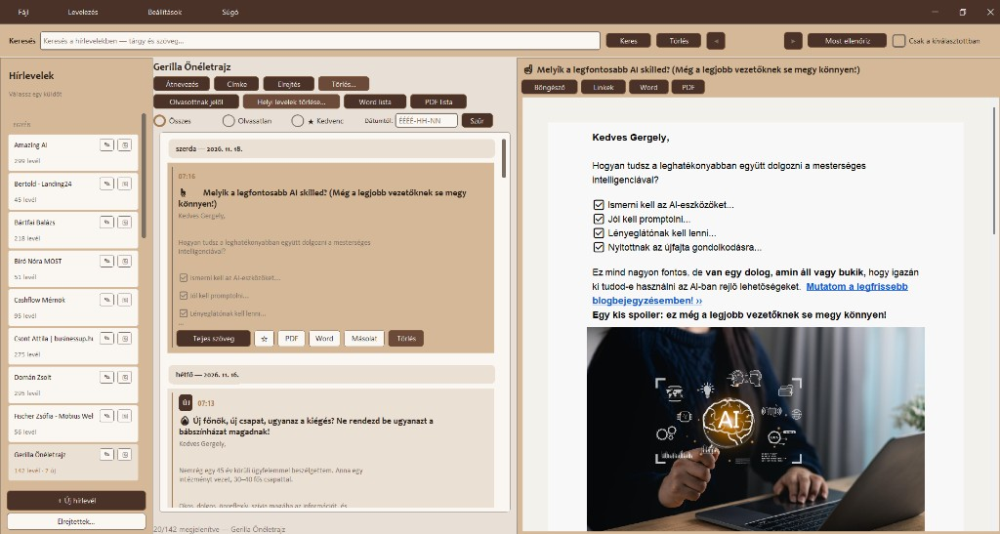

# Hírlevél követő

Windows program hírlevelek IMAP-ről történő letöltéséhez és olvasásához. A levelek és beállítások a gépeden maradnak (`%LOCALAPPDATA%\HirlevelKoveto`).

## Letöltés

**[Legújabb win64 zip](https://github.com/Gergely-hub/hirlevel-koveto/releases/latest)**

1. Töltsd le a **`HirlevelKoveto-…-win64.zip`** fájlt (Assets alatt).
2. Csomagold ki bárhova.
3. Indítsd a **`HirlevelKoveto.exe`** fájlt.
4. Windows **ismeretlen kiadó** figyelmeztetésnél: *További információ* → *Futtatás mégis*.

## Röviden

| Téma | Megjegyzés |
|------|------------|
| Platform | Windows 64 bit |
| Levelezés | IMAP (Gmail, Outlook OAuth, Yahoo, iCloud, magyar szolgáltatók, egyéni) |
| ProtonMail | Kísérleti — Proton Mail Bridge (`127.0.0.1:1143`) |
| Outlook | *Bejelentkezés Microsoft-fiókkal* a fiók ablakban |
| Adatok | `%LOCALAPPDATA%\HirlevelKoveto` |

Részlet: [OLVASD.md](OLVASD.md) · Hibajelzés: [Issues](https://github.com/Gergely-hub/hirlevel-koveto/issues) vagy a program **Súgó → Hibabejelentő…**

Jogi szövegek: a letöltött csomag `Hivatalos` mappája, illetve **Súgó → Jogi Dokumentumok Központ…**